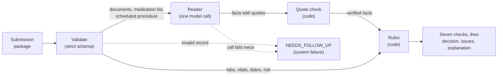

# Approach and results

## Architecture: the model reads, the code decides



1. **Validate.** A strict schema. An unknown field is an error, because a renamed `labs`
   would otherwise read as "no labs".
2. **Read.** One model call sees the documents, the medication list and the scheduled
   procedure. It returns facts, each with a document id and a verbatim quote. It sees no
   labs, structured vitals, risk level or thresholds, and it returns no decision.
3. **Verify and decide.** Code confirms each quote is in its document, then applies the
   four rules. Every case gets the same seven checks, `READY` included, and the decision,
   issues and explanation are derived from those rows.

A malformed record or a failed model call returns `NEEDS_FOLLOW_UP` for that case, marked
as a system failure.

## Design decisions

- **Quotes verified by code.** A fact counts only if its quote is in the document it
  cites, so a nurse can find everything shown. The cost: a correct fact with a mangled
  quote is discarded and the case goes to follow-up.
- **One model call per case.** It is cheap and has one failure path to handle. The cost:
  one prompt must get every kind of fact right, and a failed call loses the whole case.
- **No sampling settings.** No temperature or seed is sent, because some current models
  reject them. The cost: the quotes chosen vary between runs, so repeatability comes from
  the rules being code, not from the model.
- **Safe per case, loud on configuration.** A bad record or a failed call still sends
  that case to a nurse; a bad key, model id or empty balance stops the run. The cost: the
  entry point can end the process, which is unusual for a library function.

## Principle: doubt never passes

`READY` and `NOT_CLEARED` are both claims, and a claim needs established facts. A check
passes or fails only when that holds however the open questions resolve; otherwise it is
`UNKNOWN` and the case is `NEEDS_FOLLOW_UP`. Open questions are a quote not found in its
document, something written but not reported, an unrecognised value, and sources that
cannot be put in order.

## One evidence packet

case_00016, from the run below. It is `READY`, and it has to prove it: the nursing note
opens with a breaching 189/112, which a recheck 24 minutes later cleared. The header and
the blood-pressure row (six other rows and two older readings are omitted here):

```text
READY: all applicable checks pass
case_00016 | Elective inguinal hernia repair | procedure date 2026-03-17 | risk LOW

PASS    Blood pressure: 137/78 on 2026-03-15 08:30, limits 180/110 (earlier breach superseded by this reading)
    source: Nursing Pre-procedure Assessment 2026-03-15 #1f5be5f7
      "ADDENDUM 08:30: Re-measured 137/78 mmHg following 24 minutes in a quiet room. Reported pain 6/10 on arrival, improved after repositioning."
    rejected: 189/112 on 2026-03-15 08:06 (Nursing Pre-procedure Assessment 2026-03-15 #1f5be5f7): breach superseded by a later reading
    rejected: 123/75 on 2026-03-12 10:12 (structured vital, Cardiology clinic): older reading
```

## Assumptions

| Assumption | Basis |
|---|---|
| Windows count calendar days; the limit day is inside | Label 12 (READY at 30 days), label 09 (fails at 15 of 14) |
| Only anticoagulants need a plan, not aspirin or clopidogrel | Rule 3 "anticoagulant medication"; labels 24, 25 |
| A drug reported only in a note still counts | Labels 00, 27, 38 |
| The plan must be for the current drug, before and after | Rule 3 "before and after"; labels 18, 20 |
| The latest reading wins across vitals and notes; a later in-range recheck clears a breach | Rule 4; labels 05, 16 |
| A missing date, risk level or temperature is `MISSING_REQUIRED_DATA`; nothing is inferred | Policy's last line; labels 11, 29, 09 |
| `NOT_CLEARED` still lists every other failing category | Labels 28, 32 |
| A consent counts only if the patient signed it, for the scheduled procedure | Rule 1; labels 28, 24 |
| Doubt blocks `NOT_CLEARED` as well as `READY` | Policy's last line; no label tests it |
| Note times and structured timestamps are compared as written | Cases 08, 09, 20, 38 have both on one day; none changes |

## Results

One run of the 50 sample cases on 2026-11-10: `openai/gpt-6-luna` through OpenRouter,
driven by the stock `run_baseline.py`. 51 model calls, $0.04. What the reader returned
is saved in `data/recorded_run/`, so these numbers can be re-scored without a key.

| Measure | Result | In one line |
|---|---|---|
| Harness metrics | 50/50 valid, decisions and exact category sets | `run_evals.py`'s own metric functions on the outputs file; the Evals API step was not run |
| Fact by fact | 328 of 328 reference facts found, none missed, added or judged differently | Agreement with facts written to the same reading guide as the prompt: consistency, not independent accuracy |
| Determinism | Case 0, ten fresh calls: decision 100%, exact output 60% | Decisions are code given the facts; the text varies because the model quotes different lines |

## Limits

- **Fit to the sample.** The rules, the reader prompt and the reading guide behind the
  reference facts were written after studying these 50 labels. There are no held-out
  cases, so 50 of 50 is a consistency check and not an accuracy estimate.
- **Reference facts.** 49 were written by subagents that never saw labels, following a
  reading guide I wrote after studying the labels. Case 16 I wrote knowing its label.
- **Untested by real data.** With complete facts no check goes `UNKNOWN`, so the doubt
  paths rest on synthetic tests only.
- **Size.** `rules.py` is about 1,000 lines for a four-rule policy. What I would cut:
  merge the three places that compute "the latest item that is not superseded"
  (readings, drug statements, plans) into one, and collapse the conflict paths no sample
  case reaches into a single rule, `UNKNOWN` on any conflict.
- **Not run.** A second model or repeat run, the direct OpenAI path, the `make` targets
  and Evals API scoring.

## Next

- **Held-out evaluation.** Score on labelled cases that played no part in writing the
  rules or the prompt.
- **Long real charts.** One reader call per document; the facts are already per document.
- **In production.** Track the `UNKNOWN` rate and how often nurses override `READY`.

Built with Claude Code; the exported session shows where review changed the design.
